# Panduan admin

Panduan singkat untuk mengubah situs Try Ekky sendiri: menambah karya, mengganti tautan dan teks, lalu menerbitkannya.
Tidak perlu bisa coding. English: [admin-guide.md](admin-guide.md).

**Membuka admin:** buka admin dengan cara yang sudah ditunjukkan pemilik situs, lalu ketik PIN-mu. Jaga keduanya
tetap rahasia: jangan ditulis di chat, catatan, atau tangkapan layar.

Layar admin punya tiga baris di atas:

- **English / Bahasa Indonesia** mengganti bahasa admin. **Terbitkan** membuat perubahan tayang. **Tutup**
  menyembunyikan admin.
- **Pratinjau**, **Batalkan terbitan terakhir**, dan **Bantuan**.
- Tab: **Karya**, **Links** (Tautan), **Settings** (Pengaturan), **Text** (Teks), **Messages** (Pesan).

Perubahan belum tayang sebelum kamu menekan **Terbitkan**. Jangan muat ulang (reload) halaman saat ada perubahan yang
menunggu, nanti perubahannya hilang.

## 1. Sekali per perangkat: token GitHub

PIN hanya membuka layar admin. Untuk **menerbitkan** kamu juga perlu token GitHub: kunci pribadi yang membuat admin
bisa menyimpan perubahan ke situs. Buat di github.com dengan akun GitHub pemilik situs (atau akun yang boleh
mengubahnya).

1. Di [github.com](https://github.com), ketuk foto profilmu, lalu **Settings**.
2. Di bagian bawah menu kiri, buka **Developer settings**, lalu **Personal access tokens**, lalu
   **Fine-grained tokens**, lalu **Generate new token**.
3. **Token name:** nama yang mudah dikenali, misalnya `Admin Ekky, HP saya`.
4. **Expiration:** pilih tanggal, misalnya 90 hari. Saat habis, Terbitkan berhenti bekerja dan kamu buat token baru
   (langkahnya sama).
5. **Repository access:** pilih **Only select repositories** lalu pilih **Beansproud/ekkyarya.com**. Hanya yang ini.
6. **Permissions**, di bagian Repository permissions: ubah **Contents** menjadi **Read and write**. Yang lain biarkan
   saja (GitHub menambahkan "Metadata: Read-only" sendiri, itu tidak apa-apa).
7. Tekan **Generate token** lalu salin. GitHub hanya menampilkannya sekali.
8. Di admin, tempel di kotak **Token GitHub** lalu tekan **Simpan token**.

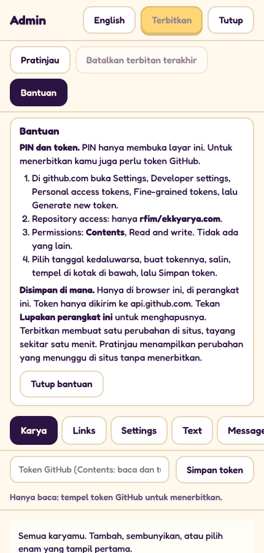

Kalau tokennya berhasil, admin menulis "Token hanya tersimpan di perangkat ini" dan tombol **Lupakan perangkat ini**
muncul.

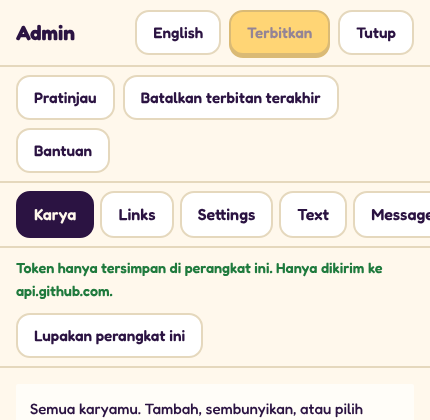

Perlu diketahui:

- Token hanya disimpan di browser ini, di perangkat ini. Token hanya dikirim ke GitHub, tidak ke mana pun.
- Tanpa token, admin tetap bisa dibuka tapi **hanya baca**: kamu bisa melihat dan mencoba, tapi Terbitkan tetap abu-abu.
- Di perangkat bersama atau pinjaman, tekan **Lupakan perangkat ini** setelah selesai. Token terhapus dari perangkat
  itu.
- HP hilang, atau ada yang melihat tokennya? Di github.com, buka halaman Fine-grained tokens yang sama dan tekan
  **Delete** di sebelahnya. Lalu buat token baru.
- Tombol **Bantuan** di admin juga menampilkan langkah-langkah ini.

## 2. Menambah karya baru

Buka tab **Karya** lalu tekan **Tambah karya**.

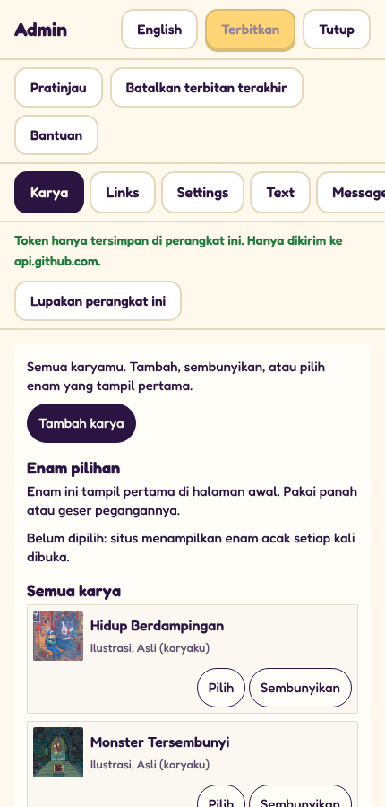

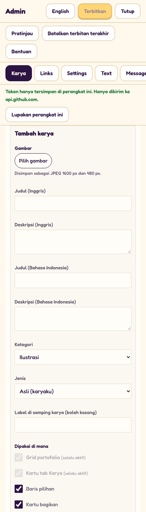

1. **Gambar:** tekan **Pilih gambar** lalu pilih filenya.
   - JPG atau PNG. Paling bagus minimal **1600 px** di sisi terpanjang; admin mengecilkannya sendiri (gambar 1600 px
     dan gambar kecil 480 px), jadi file besar tidak masalah.
   - Potong (crop) dulu sesuai yang ingin dilihat. Bagian transparan menjadi putih.
2. **Judul dan Deskripsi**, dalam **bahasa Inggris** dan **Bahasa Indonesia**. Keempatnya wajib. Singkat dan
   sederhana: judul beberapa kata, deskripsi satu atau dua kalimat. Tanpa emoji atau simbol (admin akan memberi tahu
   kalau ada). Setiap judul harus berbeda dari karya lain.
3. **Kategori:** kelompok di portofolio: **Ilustrasi**, **Web dan UI**, **Branding**, atau **Media sosial**.
4. **Jenis:** milik siapa karyanya.
   - **Asli (karyaku):** karakter atau ide Ekky sendiri.
   - **Karya klien:** dibuat untuk klien.
   - **Fan art:** karakter milik orang lain.
5. **Label di samping karya (boleh kosong):** label kecil, misalnya `Baru`. Fan art otomatis mendapat label
   "Fan art".
6. **Dipakai di mana:** centang di mana karya ini boleh muncul.
   - **Grid portofolio** dan **Kartu tab Karya**: selalu aktif. Semua karya tampil di portofolio dan di tab Karya
     aplikasi.
   - **Baris pilihan:** boleh jadi salah satu dari enam yang tampil pertama di halaman awal.
   - **Kartu bagikan:** boleh dipakai di gambar yang dibagikan orang.
   - **Halaman mewarnai:** boleh dijadikan halaman untuk diwarnai.
   - **Stiker:** boleh jadi stiker saat mewarnai.
   - **Sprite Star Catcher:** boleh muncul di dalam game Star Catcher.
   - **Seni peta dan menu:** boleh menghias peta dan menu.
   - **Latar Doodle Scene:** boleh jadi latar di halaman corat-coret kosong.
   - **Avatar:** boleh dipakai sebagai foto profil di aplikasi.
   - **Mini-game:** boleh dipakai di game-game kecil.
   - **Desa:** boleh muncul sebagai pemandangan di desa.
7. Tekan **Simpan karya**. Karya muncul di daftar dengan tanda "Belum diterbitkan". Tekan **Terbitkan** (di atas)
   kalau sudah siap.

**Aturan fan art dan karya klien.** Fan art dan karya klien **hanya ada di portofolio dan tab Karya**: tidak pernah
di halaman mewarnai, stiker, game, atau baris pilihan. Admin mengunci kotak lainnya ("tidak boleh untuk jenis ini")
saat kamu memilih jenis ini, jadi tidak mungkin salah. Hanya karya **Asli** yang boleh dipilih untuk enam pilihan.

**Mengubah atau menghapus karya yang kamu tambahkan:** tekan **Ubah** atau **Hapus** di sebelahnya. Hapus
mengeluarkannya dari situs; file gambarnya tetap tersimpan aman di belakang. Karya bawaan situs tidak bisa diubah atau
dihapus, tapi bisa disembunyikan (di bawah).

## 3. Menyembunyikan karya, dan memilih enam pilihan

Di tab **Karya**, di bagian **Semua karya**:

- **Sembunyikan** mengeluarkan karya dari situs. **Tampilkan** mengembalikannya.
- **Pilih** menambahkan karya asli ke **Enam pilihan**: enam yang tampil pertama di halaman awal. Maksimal enam.

Di bagian **Enam pilihan**:

- Pakai **panah naik dan turun**, atau tahan **pegangan** (tiga garis, di kiri) lalu geser, untuk mengubah urutan.
- **Keluarkan dari pilihan** mengeluarkannya dari enam (karyanya tetap ada di situs).
- Kalau belum ada yang dipilih, situs menampilkan enam karya acak setiap kali dibuka.

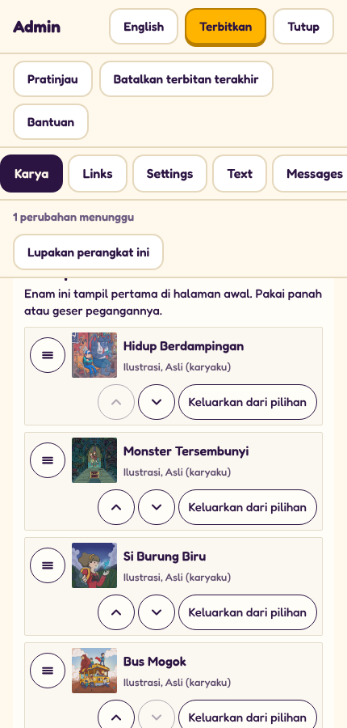

## 4. Tautan media sosial, email kontak, dan baris harga

Tab **Links** (Tautan): satu kotak untuk setiap jaringan (Instagram, Behance, LinkedIn, Website, TikTok, YouTube, X).
Tempel tautan lengkap yang diawali `https://`. Kosongkan kotak untuk tetap memakai tautan yang sekarang.

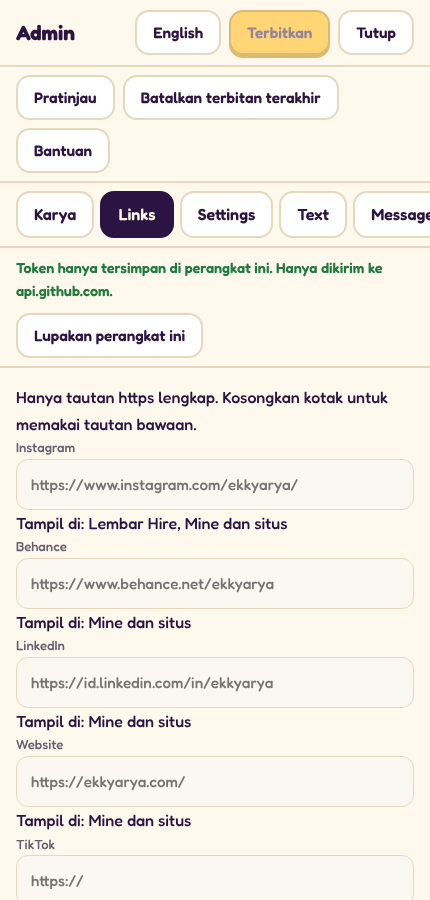

Tab **Settings** (Pengaturan):

- **Email kontak:** alamat yang dibuka tombol **Hire Ekky**.
- **Baris harga (EN)** dan **Baris harga (ID)**: kalimat harga singkat di lembar Hire, misalnya `Proyek mulai $25`.
  Tanpa emoji.
- Kotak kosong berarti "pakai yang ada di situs sekarang" (terlihat abu-abu).

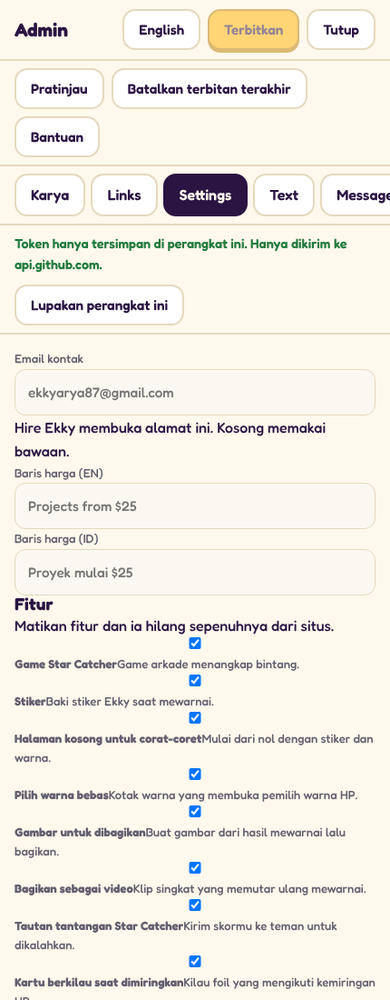

## 5. Mengubah teks apa pun

Tab **Text** (Teks): setiap baris di situs, bahasa Inggris dan Indonesia berdampingan.

1. Ketik kata di **Cari teks** (misalnya `hire` atau kata yang kamu lihat di situs).
2. Ubah kotak bahasa Inggris, kotak bahasa Indonesia, atau keduanya.
3. Salah ubah? **Kembalikan ke teks bawaan** mengembalikan baris itu.

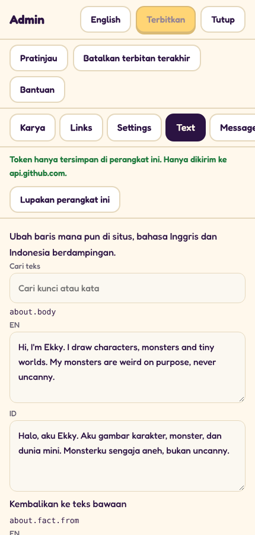

## 6. Menyalakan dan mematikan fitur

Tab **Settings**, di bagian **Fitur**: setiap sakelar punya nama sederhana dan satu baris penjelasan (game Star
Catcher, Stiker, setiap halaman mewarnai, Suara, tombol aplikasi Android, dan lainnya). Hapus centangnya dan fitur itu
hilang sepenuhnya dari situs; centang lagi untuk mengembalikannya. Lalu Terbitkan.

## 7. Pratinjau, lalu Terbitkan

Saat ada perubahan yang menunggu, baris di bawah tab menyebut berapa perubahan yang menunggu, dan **Terbitkan**
menjadi kuning.

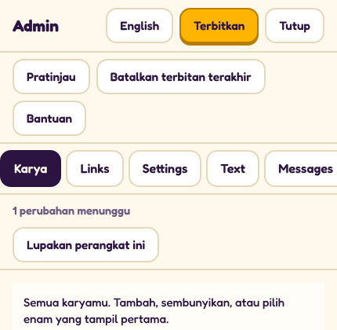

- **Pratinjau** menampilkan situs dengan perubahan yang menunggu, hanya di perangkat ini. Orang lain tidak melihatnya.
  Bar kuning bertuliskan **Pratinjau, belum diterbitkan**: tekan **Kembali ke admin** untuk lanjut mengubah, atau
  **Hentikan pratinjau** untuk melihat situs seperti sekarang.
- **Terbitkan** menayangkan semua yang menunggu sekaligus. Admin menulis **Terbit. Tayang sekitar satu menit lagi.**
  Situs ini di-host di GitHub Pages, yang butuh sekitar satu menit untuk memperbarui. Lalu muat ulang situsnya
  (kadang tunggu dua atau tiga menit).
- **Lihat commit** di sebelahnya membuka perubahan yang tersimpan di GitHub, kalau penasaran. Tidak wajib.

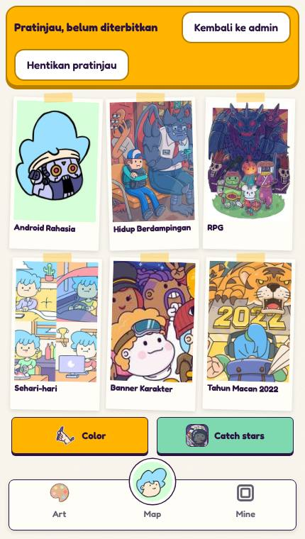

## 8. Membatalkan terbitan

Salah menerbitkan? Tekan **Batalkan terbitan terakhir**. Admin menampilkan terbitan terakhir (apa, kapan, berapa
berkas) dan bertanya untuk memastikan. Tekan **Ya, batalkan**. Situs kembali seperti sebelumnya, tayang sekitar satu
menit lagi.

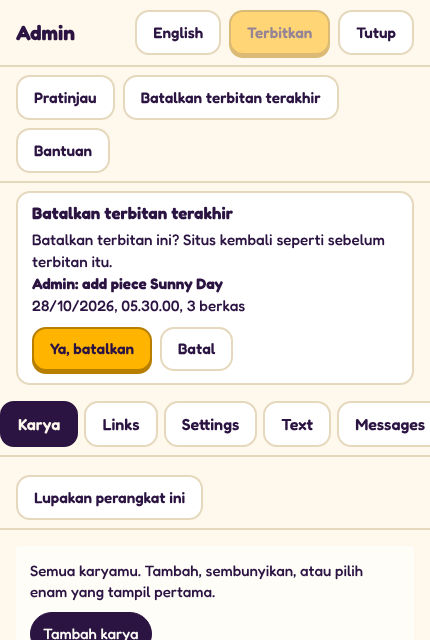

- Terbitkan atau selesaikan dulu perubahan yang menunggu; Batalkan menunggu sampai tidak ada yang menunggu.
- Membatalkan juga sebuah terbitan, jadi menekan Batalkan lagi akan mengembalikan perubahannya.
- Kalau admin menulis "Ada berkas yang berubah setelah terbitan itu", tidak ada yang diubah: minta bantuan developer.

## 9. Pesan

Saat seseorang mengisi **Hire Ekky** di situs, pesannya masuk **lewat email**, ke email kontak di Settings. Tab
**Messages** (Pesan) menjelaskan ini dan punya tombol untuk membuka kotak surat. Belum ada kotak masuk di dalam admin.

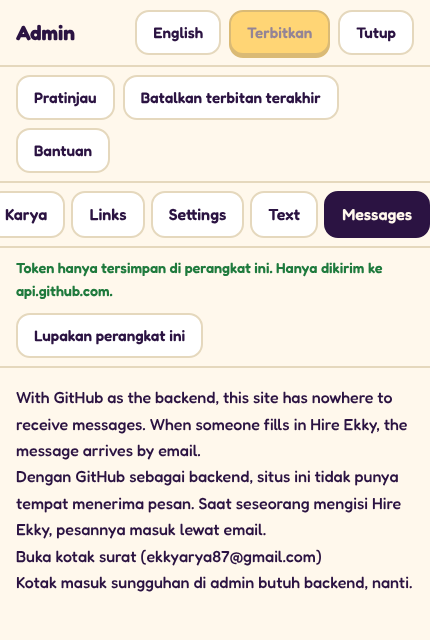

## 10. Kalau Terbitkan gagal

Perubahanmu tetap menunggu selama halaman tidak dimuat ulang, jadi kamu bisa membereskan masalahnya lalu tekan
Terbitkan lagi.

| Admin menulis | Yang dilakukan |
|---|---|
| GitHub menolak token. Pastikan token punya akses Contents baca dan tulis untuk repositori ini. | Token sudah habis, sudah dihapus, atau dibuat tanpa **Contents: Read and write** untuk **Beansproud/ekkyarya.com**. Buat token baru (bagian 1), tekan **Lupakan perangkat ini**, tempel token baru, lalu Terbitkan lagi. |
| GitHub tidak menerima token ini untuk repositori. (saat menyimpan token) | Sama seperti di atas: periksa repositori dan izin Contents, atau salin ulang tokennya (seluruhnya). |
| Tidak ada koneksi ke GitHub. | Periksa koneksi internet lalu tekan Terbitkan lagi. |
| Hanya baca: tempel token GitHub untuk menerbitkan. | Belum ada token di perangkat ini. Lihat bagian 1. |
| Daftar di bawah "Mohon perbaiki:" | Ada yang perlu diubah di formulir (judul kosong, emoji, aturan fan art atau karya klien). Perbaiki lalu simpan lagi. |
| Pesan lainnya | Tunggu sebentar lalu coba lagi. Kalau masih gagal, ambil tangkapan layar pesannya (tanpa PIN, tanpa token) dan kirim ke developer. |
