# Admin guide

A short guide for changing the Try Ekky site yourself: adding art, changing links and text, and putting it all live.
No coding needed. Bahasa Indonesia: [admin-guide-id.md](admin-guide-id.md).

**Opening admin:** open admin the way the owner showed you, and type your PIN. Keep both private: do not write them
down in chats, notes or screenshots.

The admin screen has three rows at the top:

- **Bahasa Indonesia / English** switches the admin language. **Publish** puts your changes live. **Close** hides
  admin.
- **Preview**, **Undo last publish** and **Help**.
- The tabs: **Art**, **Links**, **Settings**, **Text**, **Messages**.

Nothing you change goes live until you press **Publish**. Do not reload the page while changes are waiting, or they
are lost.

## 1. Once per device: the GitHub token

The PIN only opens the admin screen. To **publish** you also need a GitHub token: a private key that lets admin save
changes to the site. Make it on github.com with the GitHub account that owns the site (or one that can edit it).

1. On [github.com](https://github.com), tap your profile picture, then **Settings**.
2. At the bottom of the left menu, open **Developer settings**, then **Personal access tokens**, then
   **Fine-grained tokens**, then **Generate new token**.
3. **Token name:** something you will recognise, for example `Ekky admin, my phone`.
4. **Expiration:** pick a date, for example 90 days. When it runs out, Publish stops working and you make a new one
   (same steps).
5. **Repository access:** choose **Only select repositories** and pick **rfim/ekkyarya.com**. Only this one.
6. **Permissions**, under Repository permissions: set **Contents** to **Read and write**. Leave everything else as it
   is (GitHub adds "Metadata: Read-only" by itself, that is fine).
7. Press **Generate token** and copy it. GitHub shows it only once.
8. In admin, paste it in the box **GitHub token** and press **Save token**.

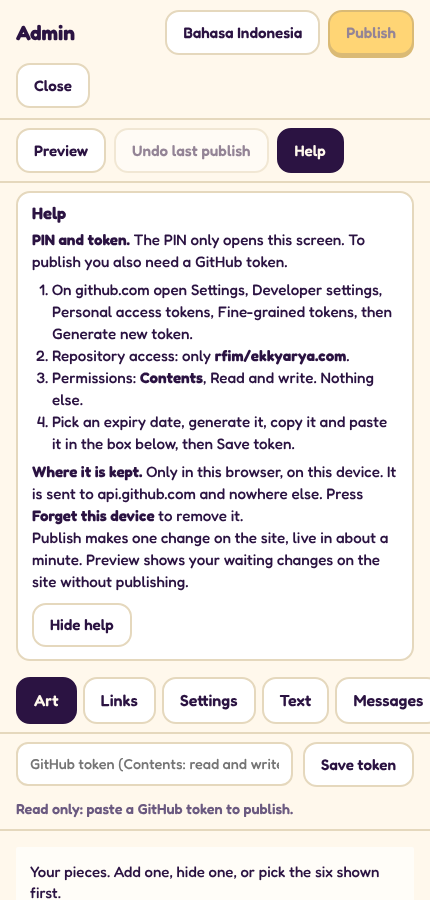

When the token works, admin says "Token saved on this device only" and the button **Forget this device** appears.

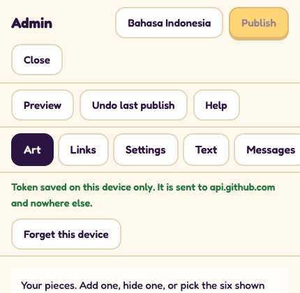

Good to know:

- The token is kept only in this browser on this device. It is sent to GitHub and nowhere else.
- Without a token, admin still opens but is **read only**: you can look and try things, but Publish stays grey.
- On a shared or borrowed device, press **Forget this device** when you are done. That removes the token from it.
- Lost a phone, or think someone saw the token? On github.com, open the same Fine-grained tokens page and press
  **Delete** next to it. Then make a new one.
- The **Help** button in admin shows these steps too.

## 2. Add a new artwork

Open the **Art** tab and press **Add a piece**.

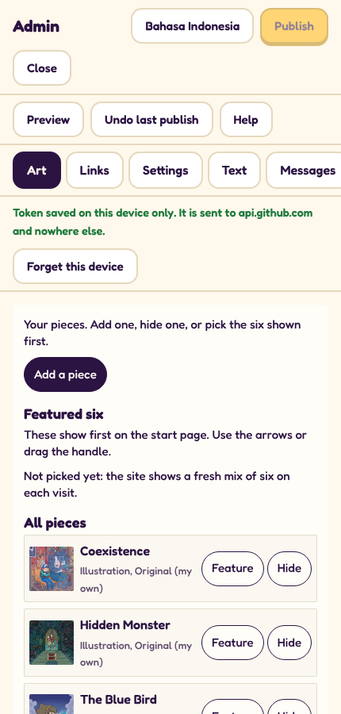

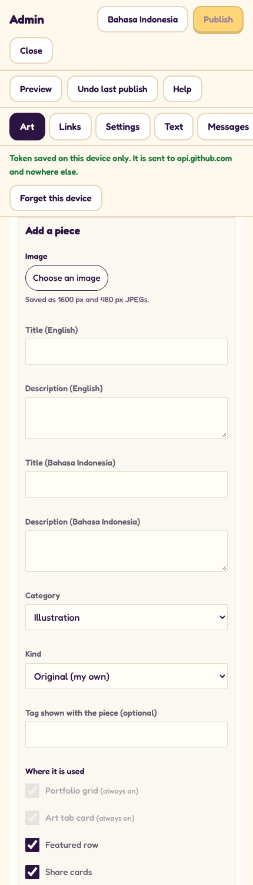

1. **Image:** press **Choose an image** and pick the file.
   - JPG or PNG. Best at least **1600 px** on the long side; admin shrinks it for you (a 1600 px picture and a 480 px
     small picture), so a big file is fine.
   - Crop it first the way you want it seen. See-through parts turn white.
2. **Title and Description**, in **English** and in **Bahasa Indonesia**. All four are needed. Short and plain: the
   title is a few words, the description one or two sentences. No emoji or symbols (admin will tell you if there are
   any). Each title must be different from the other pieces.
3. **Category:** which group of the portfolio it goes in: **Illustration**, **Web and UI**, **Branding** or
   **Social media**.
4. **Kind:** who the art belongs to.
   - **Original (my own):** Ekky's own character or idea.
   - **Client work:** made for a client.
   - **Fan art:** a character that belongs to someone else.
5. **Tag shown with the piece (optional):** a small label, for example `New`. Fan art gets the tag "Fan art" by
   itself.
6. **Where it is used:** tick where the piece may appear.
   - **Portfolio grid** and **Art tab card**: always on. Every piece shows in the portfolio and in the Art tab of the
     app.
   - **Featured row:** may be one of the six shown first on the start page.
   - **Share cards:** may be used on pictures people share.
   - **Coloring page:** may become a page to color.
   - **Stickers:** may be a sticker when coloring.
   - **Star Catcher sprite:** may appear inside the Star Catcher game.
   - **Map and menu art:** may decorate the map and menus.
   - **Doodle Scene backdrop:** may be a background on the blank doodle page.
   - **Avatar:** may be used as a profile picture in the app.
   - **Mini-games:** may be used in the small games.
   - **Village:** may appear as scenery in the village.
7. Press **Save piece**. It now shows in the list as "Not published yet". Press **Publish** (top) when ready.

**The fan art and client rules.** Fan art and client work stay in the **portfolio and the Art tab only**: never in
coloring pages, stickers, games or the featured row. Admin locks the other boxes ("not allowed for this kind") when you
pick one of these kinds, so you cannot get it wrong. Only **Original** pieces can be featured.

**Change or remove a piece you added:** press **Edit** or **Delete** next to it. Delete takes it off the site; the
picture file is kept safely in the background. Pieces that came with the site cannot be edited or deleted, but they
can be hidden (below).

## 3. Hide a piece, and choose the featured six

In the **Art** tab, under **All pieces**:

- **Hide** takes a piece off the site. **Show** brings it back.
- **Feature** adds an original piece to the **Featured six**: the six shown first on the start page. Up to six.

Under **Featured six**:

- Use the **up and down arrows**, or hold the **handle** (three lines, on the left) and drag, to change the order.
- **Remove from featured** takes it out of the six (it stays on the site).
- If none are picked, the site shows a fresh mix of six on every visit.

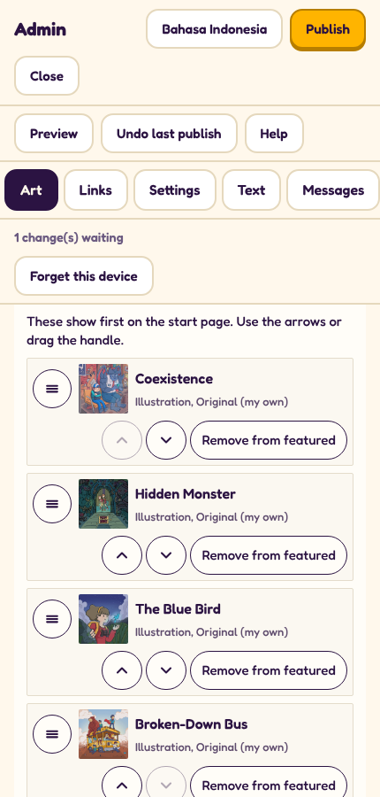

## 4. Social links, contact email and price line

**Links** tab: one box per network (Instagram, Behance, LinkedIn, Website, TikTok, YouTube, X). Paste the full link,
starting with `https://`. Leave a box empty to keep the link the site already has.

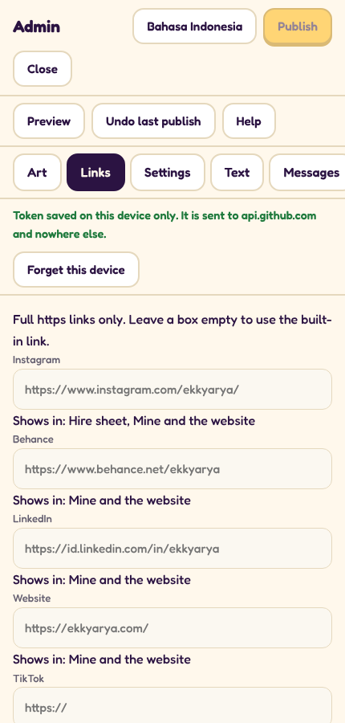

**Settings** tab:

- **Contact email:** the address the **Hire Ekky** button opens.
- **Price line (EN)** and **Price line (ID)**: the short price sentence on the Hire sheet, for example
  `Projects from $25`. No emoji.
- An empty box means "use what the site has now" (shown in grey).

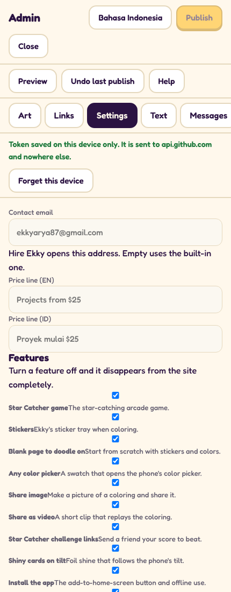

## 5. Edit any text

**Text** tab: every line of the site, English and Indonesian side by side.

1. Type a word in **Find text** (for example `hire` or a word you see on the site).
2. Change the English box, the Indonesian box, or both.
3. Made a mess? **Reset to built-in text** puts that line back.

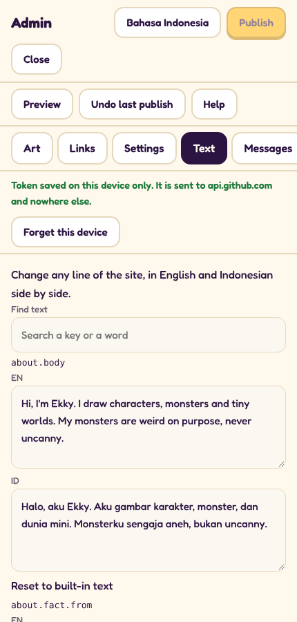

## 6. Turn features on and off

**Settings** tab, under **Features**: each switch has a plain name and a line saying what it does (Star Catcher game,
Stickers, each coloring page, Sound, the Android app button, and so on). Untick it and that feature disappears from
the site completely; tick it to bring it back. Then Publish.

## 7. Preview, then Publish

When something is waiting, the line under the tabs says how many changes are waiting, and **Publish** turns yellow.

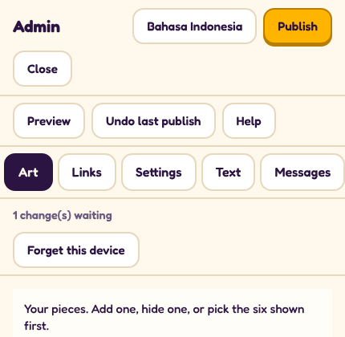

- **Preview** shows the site with your waiting changes, on this device only. Nobody else sees them. A yellow bar says
  **Preview, not published**: press **Back to admin** to keep editing, or **Stop preview** to see the site as it is
  now.
- **Publish** puts everything that is waiting live, in one go. Admin says **Published. Live in about a minute.**
  The site is hosted on GitHub Pages, which takes about a minute to update. Then refresh the site (sometimes give it
  two or three minutes).
- **See the commit** next to it opens the saved change on GitHub, if you are curious. You do not need it.

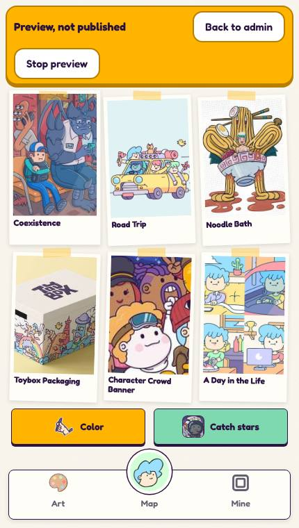

## 8. Undo a publish

Published something by mistake? Press **Undo last publish**. Admin shows the last publish (what, when, how many
files) and asks to make sure. Press **Yes, undo it**. The site goes back to how it was before, live in about a minute.

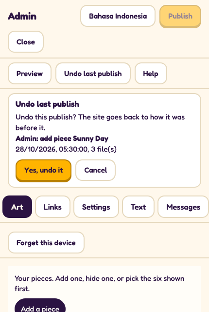

- Publish or finish any waiting changes first; Undo waits until nothing is waiting.
- Undo is itself a publish, so pressing Undo again brings the change back.
- If admin says "A file was changed after that publish", nothing was changed: ask the developer to help.

## 9. Messages

When someone fills in **Hire Ekky** on the site, the message arrives **by email**, at the contact email in Settings.
The **Messages** tab says this and has a button that opens the mailbox. There is no inbox inside admin (yet).

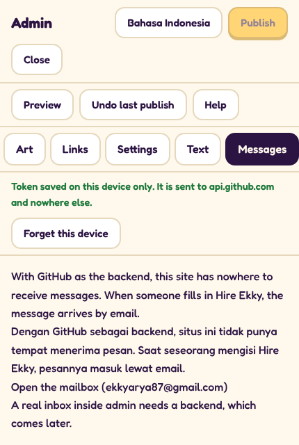

## 10. If Publish fails

Your changes stay waiting as long as you do not reload the page, so you can fix the problem and press Publish again.

| Admin says | What to do |
|---|---|
| GitHub refused the token. Check that it has Contents read and write for this repository. | The token has run out, was deleted, or was made without **Contents: Read and write** on **rfim/ekkyarya.com**. Make a new token (section 1), press **Forget this device**, paste the new one, then Publish again. |
| GitHub did not accept this token for the repository. (when saving the token) | Same as above: check the repository and the Contents permission, or copy the token again (all of it). |
| No connection to GitHub. | Check the internet connection and press Publish again. |
| Read only: paste a GitHub token to publish. | No token on this device yet. See section 1. |
| A list under "Please fix:" | Something in the form needs a change (a missing title, emoji, a rule for fan art or client work). Fix it and save again. |
| Anything else | Wait a minute and try again. If it still fails, take a screenshot of the message (no PIN, no token in it) and send it to the developer. |
